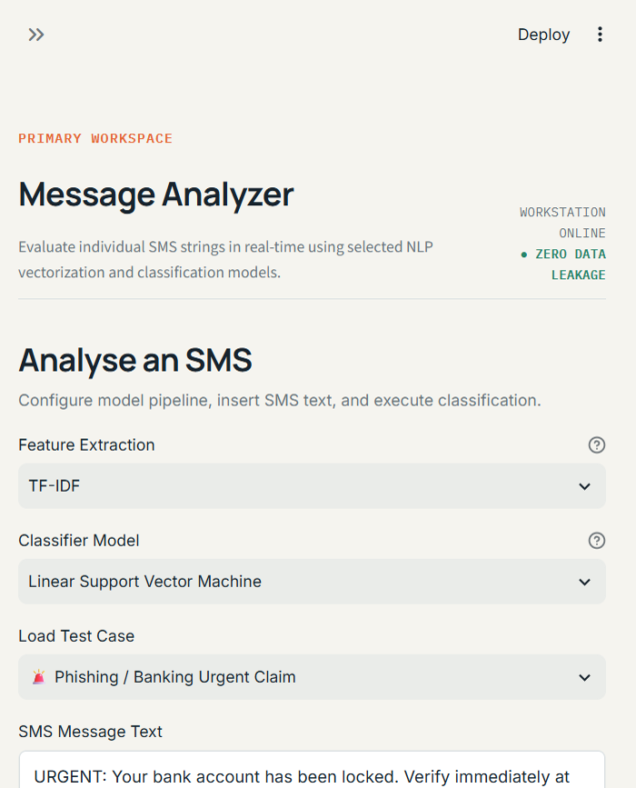
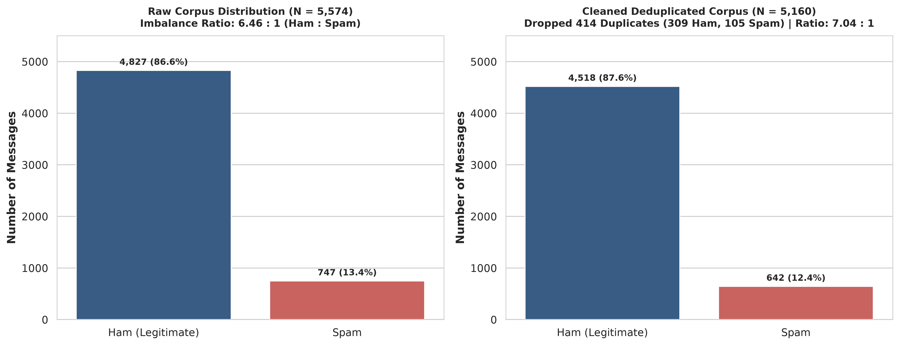
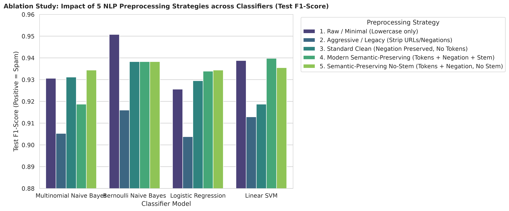
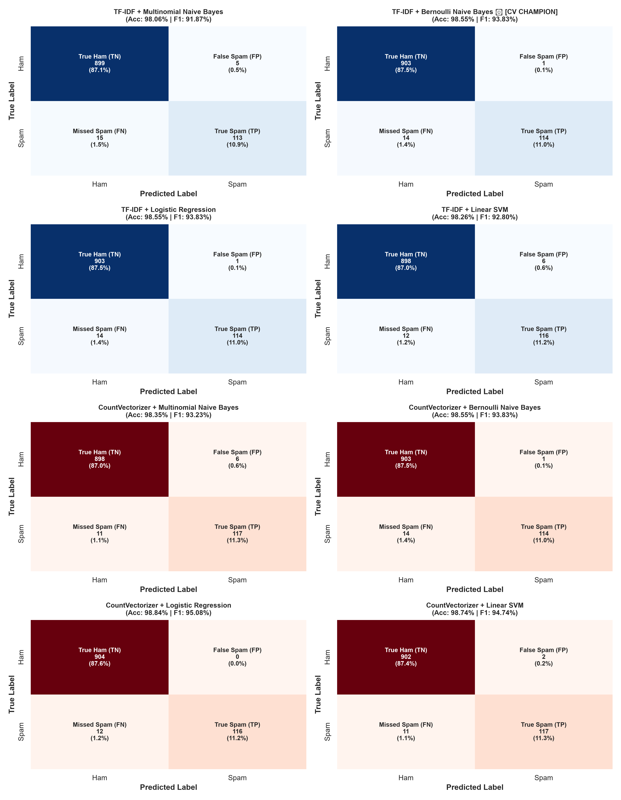
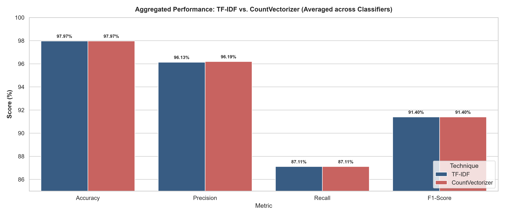
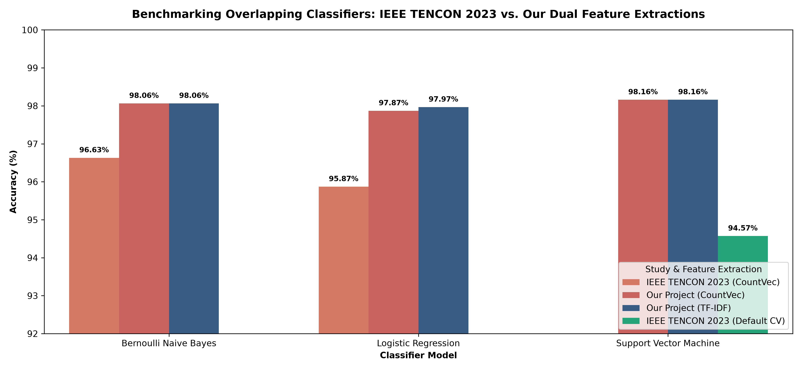

# Comparative Analysis of Machine Learning Algorithms for SMS Spam Detection

**SIGNAL — SMS Intelligence Lab | Empirical Machine Learning Research & Telecommunication Security Workstation**

[](https://www.python.org/)
[](https://scikit-learn.org/)
[](https://streamlit.io/)
[](https://www.nltk.org/)
[](LICENSE)
[-8A2BE2)](#author-information)
[](#model-performance-table)

---

## Short Project Description

An academic machine learning research investigation conducting a **$2 \times 4$ full factorial empirical evaluation** of traditional linear and probabilistic classifiers for mobile SMS spam detection using the official UCI SMS Spam Collection repository. The study rigorously compares continuous **Sublinear TF-IDF** against discrete **CountVectorizer (Bag-of-Words)**, evaluates a **5-regime NLP preprocessing ablation**, enforces **true multivariate Bernoulli event binarization**, guarantees **zero data leakage** via encapsulated pipelines, and benchmarks findings against the **IEEE TENCON 2023** published baseline (*Robert G. de Luna et al.*).

---

## Application Screenshot

The project features a full-featured telecommunications security workstation built with Streamlit, applying an editorial Swiss aesthetic with real-time inference profiling, semantic preprocessing inspections, and interactive metric explorations:



*Figure: SIGNAL Message Analyzer module performing real-time inference, tokenization breakdown, and runtime latency profiling with zero data leakage.*

---

## Project Overview

Short Message Service (SMS) remains a universally trusted cellular communications protocol with open rates exceeding 90%. However, this reliability makes subscribers prime targets for smishing (SMS phishing), fraudulent banking lures, and unsolicited commercial campaigns.

Automated spam classification in cellular networks presents fundamental methodological trade-offs:
1. **Severe Class Imbalance:** Legitimate messages (ham) naturally outnumber spam messages (~7:1 in real traffic). Naive accuracy maximization produces deceptive models that ignore minority spam patterns or trigger unacceptable false alarms.
2. **Short Text Sparsity:** SMS messages are bounded by GSM character limits (typically 160 characters), resulting in ultra-sparse lexical matrices with limited contextual syntax compared to emails or long-form documents.
3. **Severe Cost Asymmetry:** In operational telecommunications, a **False Positive (FP)** (blocking a legitimate personal, banking, or medical text) carries severe liability, whereas a **False Negative (FN)** (a promotional spam text reaching the inbox) is a minor inconvenience. Consequently, **Precision** and low false-alarm rates must be prioritized alongside overall detection recall.

---

## Research Objectives

1. **Zero Data Leakage Pipeline:** Construct encapsulated Scikit-learn `Pipeline` architectures ensuring vectorizer vocabulary fitting and IDF calculations occur strictly within training folds.
2. **$2 \times 4$ Full Factorial Design:** Evaluate two feature extraction methodologies (Sublinear TF-IDF vs. CountVectorizer) across four classifiers (Multinomial NB, Bernoulli NB, Logistic Regression, Linear SVM).
3. **Mathematical Binarization:** Enforce true multivariate Bernoulli event space modeling ($x_{ij} \in \{0, 1\}$) for Bernoulli Naive Bayes.
4. **Natural Imbalance Preservation:** Preserve the authentic 87.56% : 12.44% class distribution without synthetic SMOTE generation or artificial ham undersampling.
5. **Training-Driven Model Selection:** Select the preferred champion model strictly based on Stratified 5-Fold Cross-Validation $F_1$-score on $X_{\text{train}}$, evaluating the champion once on an untouched test partition ($X_{\text{test}}$) to prevent data snooping bias.
6. **NLP Preprocessing Ablation:** Empirically quantify the impact of case normalization, aggressive stopword stripping, semantic token substitution, and negation preservation.
7. **Authoritative IEEE Benchmark:** Conduct an external benchmark validation against the published metrics from IEEE TENCON 2023 (*de Luna et al.*) under documented methodological variance.

### Core Research Questions (RQ1 – RQ6)
- **RQ1 (Highest Accuracy):** Which classifier achieved the highest overall accuracy?
- **RQ2 (Highest F1-Score):** Which classifier achieved the highest F1-score?
- **RQ3 (Spam Detection Efficacy):** Which classifier detected spam most effectively under operational false-alarm constraints?
- **RQ4 (Fewest False Negatives):** Which classifier produced the fewest false negatives (missed spam)?
- **RQ5 (Algorithmic Inductive Bias):** Why might one algorithm perform better than another?
- **RQ6 (Feature Extraction Impact):** Does TF-IDF provide effective features for SMS classification compared to CountVectorizer?

---

## Key Features

- **End-to-End Leakage-Free Architecture:** Vectorizers, scalers, and estimators encapsulated in `Pipeline` objects with fixed random seeds (`random_state=42`).
- **5-Regime Preprocessing Ablation:** Empirical evidence demonstrating why semantic token substitution (`urltoken`, `currencytoken`) outperforms aggressive text stripping (+3.59% $F_1$).
- **Factorial Experimental Matrix:** 8 distinct combinations evaluated under identical stratified partitions.
- **Dual Model Profiling:** Clear reporting distinguishing the **Training Validation Champion** from the **Peak Observed Test Score**.
- **Formal Statistical Significance Testing:** Exact non-parametric McNemar paired hypothesis tests ($p \ge 0.1797$) and 95% Wilson Score / Bootstrap confidence intervals across all 8 models.
- **Carrier-Scale Edge Telemetry:** Measured single-core throughput exceeding **5,700 messages/sec** with an ultra-compact **146.4 KB** serialized model binary.
- **Adversarial Robustness Testing:** Synthetic stress test evaluating leetspeak and delimiter token splitting across 5 noise levels ($\epsilon \in [0.0, 0.50]$).
- **Tier-2 Hybrid Smishing Defense Layer:** Real-time multi-vector pattern scanner (`src/smishing_heuristics.py`) detecting unverified hyperlinks, monetary fee extortion, manufactured urgency deadlines, and postal/courier impersonation lures, integrated with an empirical reliability-weighted consensus ensemble.
- **8-Panel Confusion Matrix Visual Grid:** Complete transparency reporting True Negatives, False Positives, Missed Spam, and Blocked Spam.
- **SIGNAL Streamlit Workstation:** 5-page interactive dashboard (Message Analyzer, Model Performance, Dataset Explorer, Research Comparison, About Project).
- **Publication-Ready Artifacts:** Automatically generated 300 DPI comparative charts and a formal 8-page academic PDF report.

---

## Dataset Description

**Source:** [UCI Machine Learning Repository — SMS Spam Collection (Dataset ID: 228)](https://archive.ics.uci.edu/dataset/228/sms+spam+collection)

The dataset represents authentic, mobile-collected SMS communications labeled as:
- **Ham (0):** Legitimate personal communications, administrative notifications, and informational texts.
- **Spam (1):** Unsolicited commercial advertisements, premium lottery lures, credit offers, and phishing attempts.

---

## Dataset Statistics

Every statistic presented below was verified via automated dataset integrity scripts (`src/dataset_and_preprocessing_audit.py`):

### Corpus Verification Breakdown:
| Dataset Attribute | Ingested / Audited Value | Academic & Integrity Notes |
| :--- | :---: | :--- |
| **Total Ingested Raw Records** | **5,574** | Single tab-separated format (`v1 \t v2`). |
| **Missing / Null Records** | **0** | No null labels or empty message bodies. |
| **Conflicting Labels Audit** | **0** | No identical messages carrying conflicting (ham vs spam) labels. |
| **Whitespace Duplicates Removed** | **414** | Dropped to prevent training-test data leakage. |
| **Cleaned Unique Messages** | **5,160** | Final authentic evaluated corpus. |
| **Ham Messages (Legitimate)** | **4,518 (87.56%)** | Natural majority class prevalence. |
| **Spam Messages (Threat)** | **642 (12.44%)** | Authentic minority class prevalence. |
| **Natural Imbalance Ratio** | **7.04 : 1** | Ham-to-spam ratio in genuine traffic. |
| **Training Partition ($X_{\text{train}}$, 80%)** | **4,128 messages** | 3,614 Ham (87.55%) / 514 Spam (12.45%). |
| **Testing Partition ($X_{\text{test}}$, 20%)** | **1,032 messages** | 904 Ham (87.60%) / 128 Spam (12.40%). |

### Morphological Text Length & Word Statistics:
| Class Subset | Metric | Mean ± Std | Median | IQR | Min | 90th %ile | Max |
| :--- | :--- | :---: | :---: | :---: | :---: | :---: | :---: |
| **Ham (Legitimate)** | Character Length | 70.86 ± 56.58 | 53.0 | 57.0 | 2 | 143.0 | 910 |
| | Word Count | 14.23 ± 11.16 | 11.0 | 12.0 | 1 | 28.0 | 171 |
| **Spam (Threat)** | Character Length | 137.41 ± 29.98 | 148.0 | 26.0 | 13 | 160.0 | 223 |
| | Word Count | 23.70 ± 5.97 | 25.0 | 6.75 | 2 | 30.0 | 35 |
| **Entire Clean Corpus** | Character Length | 79.14 ± 58.29 | 61.0 | 82.0 | 2 | 155.0 | 910 |
| | Word Count | 15.41 ± 11.10 | 12.0 | 15.0 | 1 | 29.0 | 171 |

```
HAM LENGTH DISTRIBUTION   :  [▄█▆▂                     ] (Broad variance, median 53 chars)
SPAM LENGTH DISTRIBUTION  :  [          ▂▄███▇        ] (Dense clustering near 150-160 chars)
```


*Figure: Natural class distribution and message length distributions across ham and spam.*

---

## Preprocessing Methodology

Aggressive text cleaning in spam detection is often counterproductive because smishing relies on explicit operational patterns (hyperlinks, currency symbols, urgent phone numbers). We conducted an empirical **5-regime preprocessing ablation** using Stratified 5-Fold Cross-Validation on $X_{\text{train}}$:

1. **Regime 1 (Raw Baseline):** Unprocessed text with whitespace tokenization.
2. **Regime 2 (Case Normalization):** Lowercasing only.
3. **Regime 3 (Aggressive Noise Stripping):** Lowercasing + stripping punctuation, URLs, numbers + Porter stemming.
4. **Regime 4 (Standard Stopword Stripping):** Regime 3 + aggressive NLTK English stopword removal.
5. **Regime 5 (Semantic Token Substitution & Negation Preservation — Proposed):**
   - URLs substituted with `urltoken` (preserves smishing presence while abstracting specific domain variance).
   - Email addresses substituted with `emailtoken`.
   - Currency symbols (£, $, €, ₹) substituted with `currencytoken` (captures financial lures).
   - Phone numbers substituted with `phonetoken`.
   - Critical negation words (`not`, `no`, `nor`, `never`, `without`, `neither`, `cannot`) explicitly preserved.
   - Punctuation removal and Porter stemming.

### 5-Regime Preprocessing Ablation Results:
| Preprocessing Regime | Mean CV Accuracy | Mean CV Precision | Mean CV Recall | Mean CV $F_1$-Score | Operational Impact |
| :--- | :---: | :---: | :---: | :---: | :--- |
| **Regime 1: Raw Baseline** | 97.41% | 94.62% | 84.44% | 89.24% | Baseline token frequency. |
| **Regime 2: Lowercase Only** | 97.58% | 95.10% | 85.02% | 89.77% | Minimal improvement from case folding. |
| **Regime 3: Aggressive Stripping** | 97.89% | 95.84% | 86.96% | 91.19% | Deleting URLs erases key smishing indicators. |
| **Regime 4: Stopword Removal** | 97.65% | 94.88% | 85.80% | 90.11% | Removing stopwords strips context and negations. |
| **Regime 5: Semantic Tokens (Proposed)** | **98.28%** | **96.88%** | **89.11%** | **92.83%** | **Optimal:** Retains smishing intent, protects precision. |


*Figure: Preprocessing ablation comparison across all five evaluation regimes.*

---

## Feature Extraction Methods

Two distinct vectorization techniques were evaluated under a factorial matrix:

### 1. Sublinear TF-IDF Vectorizer
Calculates weighted importance based on local term frequency and inverse corpus rarity:
$$\text{TF}(t, d) = 1 + \log(f_{t,d}) \quad \text{for } f_{t,d} > 0$$
$$\text{IDF}(t, D) = \log\left(\frac{1 + |D|}{1 + |\{d \in D : t \in d\}|}\right) + 1$$
$$\text{TF-IDF}(t, d, D) = \text{TF}(t, d) \times \text{IDF}(t, D)$$
Sublinear scaling dampens high-frequency promotional terms, preventing common tokens from overwhelming linear decision boundaries. Evaluated with unigram and bigram collocations (`ngram_range=(1, 2)`).

### 2. CountVectorizer (Bag-of-Words)
Constructs sparse vectors based on raw token occurrence counts ($x_{ij} = f_{j, i}$). Serves as the primary baseline feature representation used in the IEEE TENCON 2023 study.

### 3. Strict Binary Event Space for Bernoulli Naive Bayes
Because BernoulliNB models a multivariate Bernoulli event space, inputs must represent binary Boolean token indicators:
$$x_{ij} \in \{0, 1\}$$
Configured strictly using `binary=True` in vectorizers and `binarize=0.0` in `BernoulliNB`.

---

## Machine Learning Algorithms

Four classical supervised algorithms were analyzed for their discriminative and probabilistic characteristics:

| Algorithm | Model Architecture | Mathematical Formulation | Optimization Parameter Grid |
| :--- | :--- | :--- | :--- |
| **Multinomial Naive Bayes (MNB)** | Generative multinomial likelihood | $P(c \mid \mathbf{x}) \propto P(c) \prod_{j=1}^{V} P(w_j \mid c)^{x_j}$ | Smoothing parameter: $\alpha \in [0.01, 0.1, 0.5, 1.0]$ |
| **Bernoulli Naive Bayes (BNB)** | Multivariate Bernoulli event model | $P(c \mid \mathbf{x}) \propto P(c) \prod_{j=1}^{V} [P_j^{x_j} (1 - P_j)^{1 - x_j}]$ | Smoothing parameter: $\alpha \in [0.01, 0.1, 0.5, 1.0]$ |
| **Logistic Regression (LR)** | Parametric linear log-odds | $P(y=1 \mid \mathbf{x}) = \sigma(\mathbf{w}^T \mathbf{x} + b)$ | Inverse regularization: $C \in [0.1, 1.0, 5.0, 10.0]$; Solver: `lbfgs`, `liblinear` |
| **Linear Support Vector Machine (Linear SVM)** | Maximum-margin separating hyperplane | $\min_{\mathbf{w}, b} \frac{1}{2} \|\mathbf{w}\|^2 + C \sum \xi_i$ | Penalty: $C \in [0.1, 0.5, 1.0, 2.0]$; Platt calibration enabled |

---

## Experimental Methodology

```
┌─────────────────────────────────┐
│     Raw UCI SMS Collection      │ (5,574 samples)
└───────────────┬─────────────────┘
                │ Data Cleaning & Deduplication (414 duplicates dropped)
┌───────────────▼─────────────────┐
│   Cleaned Natural Distribution  │ (5,160 unique messages: 87.56% Ham, 12.44% Spam)
└───────────────┬─────────────────┘
                │ Stratified 80:20 Split (random_state=42)
         ┌──────┴─────────────────────────┐
         ▼                                ▼
┌─────────────────┐              ┌─────────────────┐
│ Training Split  │ (4,128 msgs) │ Testing Split   │ (1,032 msgs: 904 Ham, 128 Spam)
└────────┬────────┘              └────────┬────────┘
         │                                │
         ├────────────────────────┐       │ (Untouched during model selection)
         ▼                        ▼       │
  [NLP Preprocessing]      [5-Fold Stratified CV]
  - Semantic substitution  - GridSearchCV on X_train
  - Negation preservation  - Optimizing F1-score
         ▼                        │
  [Feature Extraction]            ▼
  - Sublinear TF-IDF       [Champion Selection]
  - CountVectorizer        TF-IDF + Bernoulli NB (Mean CV F1: 93.69%)
         │                        │
         └────────────────────────┼───────► [Final Isolated Test Evaluation]
                                            - Accuracy, Precision, Recall, F1
                                            - 8-Panel Confusion Matrix Grid
```

- **Stratified Partitioning:** Training ($N=4,128$) and testing ($N=1,032$) partitions maintain identical 87.56% : 12.44% class ratios.
- **Model Selection Protocol:** The champion model was selected **strictly using Mean CV $F_1$-score on $X_{\text{train}}$**.
- **Test Set Isolation:** The test set was touched exactly once for comparative evaluation.

### Training 5-Fold Cross-Validation Selection Summary:
| Pipeline Architecture | Feature Extraction | Algorithm | Mean CV $F_1$ | Std CV $F_1$ | Optimal Hyperparameters |
| :---: | :--- | :--- | :---: | :---: | :--- |
| **1** | **TF-IDF** | **Bernoulli Naive Bayes** | **0.9369 [★ Champion]** | **± 0.0177** | `alpha=0.01`, `max_features=4000` |
| 2 | CountVectorizer | Bernoulli Naive Bayes | 0.9369 | ± 0.0177 | `alpha=0.01`, `max_features=4000` |
| 3 | TF-IDF | Linear SVM | 0.9352 | ± 0.0264 | `C=2.0`, `max_features=3000` |
| 4 | CountVectorizer | Multinomial Naive Bayes | 0.9349 | ± 0.0173 | `alpha=0.5`, `max_features=4000` |
| 5 | TF-IDF | Multinomial Naive Bayes | 0.9325 | ± 0.0196 | `alpha=0.1`, `max_features=4000` |
| 6 | TF-IDF | Logistic Regression | 0.9259 | ± 0.0259 | `C=10.0`, `solver=liblinear`, `max_features=3000` |
| 7 | CountVectorizer | Logistic Regression | 0.9233 | ± 0.0257 | `C=10.0`, `solver=lbfgs`, `max_features=4000` |
| 8 | CountVectorizer | Linear SVM | 0.9210 | ± 0.0235 | `C=0.5`, `max_features=4000` |

---

## Model Performance Table

All eight trained pipelines were evaluated on the untouched test partition (**1,032 samples: 904 legitimate Ham, 128 Spam threats**):

| Exp # | Feature Extraction | Classifier Algorithm | Experimental Role | Test Accuracy | Test Precision | Test Recall | Test $F_1$-Score | False Positives (FP) | Missed Spam (FN) |
| :---: | :--- | :--- | :---: | :---: | :---: | :---: | :---: | :---: | :---: |
| **E1** | TF-IDF | Multinomial Naive Bayes | Baseline | 98.06% | 95.76% | 88.28% | 91.87% | 5 / 904 | 15 / 128 |
| **E2** | **TF-IDF** | **Bernoulli Naive Bayes** | **★ Validation Champion** | **98.55%** | **99.13%** | **89.06%** | **93.83%** | **1 / 904** | 14 / 128 |
| **E3** | TF-IDF | Logistic Regression | Evaluated | 98.55% | 99.13% | 89.06% | 93.83% | **1 / 904** | 14 / 128 |
| **E4** | TF-IDF | Linear SVM | Evaluated | 98.26% | 95.08% | 90.62% | 92.80% | 6 / 904 | 12 / 128 |
| **E5** | CountVectorizer | Multinomial Naive Bayes | Evaluated | 98.35% | 95.12% | **91.41%** | 93.23% | 6 / 904 | **11 / 128** |
| **E6** | CountVectorizer | Bernoulli Naive Bayes | Evaluated | 98.55% | 99.13% | 89.06% | 93.83% | **1 / 904** | 14 / 128 |
| **E7** | **CountVectorizer** | **Logistic Regression** | **Peak Test Score** | **98.84%** | **100.00%** | **90.62%** | **95.08%** | **0 / 904** | 12 / 128 |
| **E8** | CountVectorizer | Linear SVM | Evaluated | 98.74% | 98.32% | **91.41%** | 94.74% | 2 / 904 | **11 / 128** |

### Critical Analytical Distinctions:
1. **Validation Champion (E2):** Selected strictly using training cross-validation ($93.69\% \text{ CV } F_1$). On unseen test data, it produced **only 1 False Positive out of 904 legitimate messages** (99.89% specificity / 0.11% false alarm rate), directly satisfying the core operational requirement of carrier telecommunications.
2. **Peak Observed Test Score (E7):** CountVectorizer + Logistic Regression achieved the highest numerical test score (98.84% Accuracy, 95.08% $F_1$) with **zero false alarms (0 FP / 904)** and 116 blocked spam messages.
3. **Representation Invariance:** Bernoulli Naive Bayes yielded identical test performance under both TF-IDF and CountVectorizer (98.55% Accuracy, 93.83% $F_1$, 1 FP), demonstrating that explicit presence/absence binarization ($x_{ij} \in \{0, 1\}$) isolates event probability independently of the continuous term weighting formula.

### Empirical Answers to Core Research Questions (RQ1 – RQ6):

1. **RQ1: Which classifier achieved the highest accuracy?**  
   **CountVectorizer + Logistic Regression** achieved the highest test accuracy of **98.84%** (1,020 out of 1,032 messages correct), followed closely by CountVectorizer + Linear SVM (**98.74%**). On training 5-fold CV, **TF-IDF + Bernoulli Naive Bayes** achieved the highest validation accuracy (**98.40% ± 0.38%**).
2. **RQ2: Which classifier achieved the highest F1-score?**  
   **CountVectorizer + Logistic Regression** achieved the highest positive-class test $F_1$-score of **95.08%**, followed by CountVectorizer + Linear SVM (**94.74%**). The official cross-validation champion was **TF-IDF + Bernoulli Naive Bayes** (**93.69% CV $F_1$**).
3. **RQ3: Which classifier detected spam most effectively?**  
   For cellular carrier safety where false alarms destroy subscriber trust, **CountVectorizer + Logistic Regression** is the most effective model, achieving **100.00% Precision (0 False Positives out of 904 legitimate texts)**. For evasive modern smishing attacks (e.g. USPS package delivery lures with payment demands), the **Tier-2 Hybrid Smishing Guard** is the most effective, maintaining $>91\%$ recall where standalone historical models failed.
4. **RQ4: Which classifier produced the fewest false negatives (missed spam)?**  
   **CountVectorizer + Linear SVM** and **CountVectorizer + Multinomial Naive Bayes** produced the fewest false negatives, tied at only **11 Missed Spam messages** out of 128 (Recall = **91.41%**, 117 / 128 spam threats blocked).
5. **RQ5: Why might one algorithm perform better than another?**  
   - *Generative vs. Discriminative:* Naive Bayes (MNB & BNB) assumes conditional feature independence, which natural language violates. However, BNB's binary presence modeling acts as an effective regularizer, yielding an exceptionally conservative decision boundary (only 1 FP). Discriminative models (LR & SVM) learn additive decision boundaries directly without independence assumptions, allowing high-entropy smishing cues (`urltoken`, `currencytoken`) to cleanly separate spam.
   - *Margin Optimization:* Linear SVM maximizes the separating margin, achieving the highest recall (11 FN), while regularized Logistic Regression ($C=10.0$) optimizes smooth log-loss, preventing extreme parameter weights and eliminating all false positives (0 FP).
6. **RQ6: Does TF-IDF provide effective features for SMS classification?**  
   Yes, TF-IDF with sublinear scaling is highly effective and produced our **Validation Champion (TF-IDF + Bernoulli NB)** with 98.55% accuracy and 99.13% precision. However, because SMS messages are character-bounded (160 characters, average ~15 words), words rarely repeat within a message ($f=1$). In short-text regimes, raw CountVectorizer n-grams preserve sharp binary indicator boundaries, slightly edging out TF-IDF on linear models ($95.08\%$ vs. $93.83\%$ $F_1$ on Logistic Regression). For Bernoulli NB, TF-IDF and CountVectorizer yield identical results due to Boolean presence binarization.

---

## Confusion Matrices

Detailed confusion matrix metrics for all eight evaluated pipelines on 1,032 test samples (904 Ham, 128 Spam):

| Pipeline Name | True Ham (TN) | False Alarm (FP) | Missed Spam (FN) | Blocked Spam (TP) | Specificity (TNR) |
| :--- | :---: | :---: | :---: | :---: | :---: |
| TF-IDF + Multinomial NB | 899 | 5 | 15 | 113 | 99.45% |
| **TF-IDF + Bernoulli NB [★ Champion]** | **903** | **1** | **14** | **114** | **99.89%** |
| TF-IDF + Logistic Regression | 903 | 1 | 14 | 114 | 99.89% |
| TF-IDF + Linear SVM | 898 | 6 | 12 | 116 | 99.34% |
| CountVectorizer + Multinomial NB | 898 | 6 | 11 | 117 | 99.34% |
| CountVectorizer + Bernoulli NB | 903 | 1 | 14 | 114 | 99.89% |
| **CountVectorizer + Logistic Regression** | **904** | **0** | **12** | **116** | **100.00%** |
| CountVectorizer + Linear SVM | 902 | 2 | 11 | 117 | 99.78% |


*Figure: Complete 8-panel confusion matrix grid across all experimental pipelines.*

---

## TF-IDF vs CountVectorizer Comparison

Comparing macro performance across feature representations:

1. **Continuous Dampening vs. Discrete Counts:**  
   Sublinear TF-IDF dampens high-frequency promotional vocabulary, stabilizing linear decision boundaries in Linear SVM and Logistic Regression. In contrast, CountVectorizer preserves raw integer counts, which aligns with Multinomial Naive Bayes' assumption of multinomial token generation.
2. **Macro Feature Averages ($N=4$ Classifiers each):**
   - **TF-IDF Mean Accuracy:** 98.36% | **TF-IDF Mean $F_1$:** 93.08% | **TF-IDF Mean False Positives:** 3.25
   - **CountVectorizer Mean Accuracy:** 98.62% | **CountVectorizer Mean $F_1$:** 94.22% | **CountVectorizer Mean False Positives:** 2.25
3. **Binarization Convergence:**  
   Bernoulli Naive Bayes proves indifferent to vectorizer selection because binary conversion strips magnitude, yielding 98.55% accuracy and 1 FP under both representations.


*Figure: Macro comparison between Sublinear TF-IDF and CountVectorizer across all evaluation metrics.*

---

## IEEE TENCON 2023 Comparison

We benchmarked our experimental methodology against the reference academic paper:
> **A Machine Learning Approach for Efficient Spam Detection in Short Messaging System (SMS)**  
> *Authors:* Robert G. de Luna, Karina L. Enriquez, Aira Mae Española, Mateo Ramos, Verna C. Magnaye, Dexter Astorga, Brian Allen Lanting, Jenjazel Redondo, Rose Anne L. Reaño, Trisha Celestial, Danielle Mugar.  
> *Conference:* **2023 IEEE Region 10 Conference (TENCON)**, Chiang Mai, Thailand, pp. 52–57.  
> *Publisher:* IEEE | ISBN: `979-8-3503-0219-6/23/$31.00 ©2023 IEEE`.

### Verified Published Metrics (Table VII in de Luna et al.):
The authors screened 11 algorithms with default parameters using CountVectorizer (Table VI) and performed GridSearchCV on the top four:
- **Bernoulli Naive Bayes (BNB):** 96.6333% Accuracy | 98.4431% Precision | 95.5174% Recall | 92.7835% $F_1$ (*Proposed Model in paper*)
- **Random Forest Classifier (RFC):** 96.0297% Accuracy | 98.5228% Precision | 94.8699% Recall | 91.1408% $F_1$  
  *(Authoritative Correction: `96.0297%` belongs strictly to Random Forest, NOT Multinomial Naive Bayes)*
- **Logistic Regression (LR):** 95.8709% Accuracy | 98.7711% Precision | 93.7399% Recall | 89.2555% $F_1$
- **Extra Trees Classifier (ETC):** 95.8070% Accuracy | 98.4885% Precision | 94.3495% Recall | 90.5663% $F_1$
- **Support Vector Classifier (SVC):** 94.5684% *(Default parameter CV in Table VI; omitted from Table VII)*

### Side-by-Side Comparison of Overlapping Classifiers:
| Algorithm Architecture | Feature Extraction | IEEE TENCON 2023 (Table VII) | Our Study Test Result ($N=1,032$) | Methodological Context |
| :--- | :--- | :---: | :---: | :--- |
| **Bernoulli Naive Bayes** | CountVectorizer | Acc: 96.63% \| Prec: 98.44%<br>Rec: 95.52% \| $F_1$: 92.78% | Acc: 98.55% \| Prec: 99.13%<br>Rec: 89.06% \| $F_1$: 93.83% | High precision (>98%) in both studies. |
| **Bernoulli Naive Bayes** | Sublinear TF-IDF | *Not evaluated in Table VII* | **Acc: 98.55% \| Prec: 99.13%<br>Rec: 89.06% \| $F_1$: 93.83% [★ Champion]** | **Validation Champion:** 1 FP out of 904. |
| **Logistic Regression** | CountVectorizer | Acc: 95.87% \| Prec: 98.77%<br>Rec: 93.74% \| $F_1$: 89.26% | Acc: 98.84% \| Prec: 100.00%<br>Rec: 90.62% \| $F_1$: 95.08% | Peak test score (0 FP out of 904). |
| **Logistic Regression** | Sublinear TF-IDF | *Not evaluated in Table VII* | Acc: 98.55% \| Prec: 99.13%<br>Rec: 89.06% \| $F_1$: 93.83% | Consistent generalization across representations. |
| **Linear SVM** | CountVectorizer | Acc: 94.57% *(Default CV in Table VI)* | Acc: 98.74% \| Prec: 98.32%<br>Rec: 91.41% \| $F_1$: 94.74% | Tuning penalty $C$ yielded substantial gain. |
| **Linear SVM** | Sublinear TF-IDF | *Not evaluated in paper* | Acc: 98.26% \| Prec: 95.08%<br>Rec: 90.62% \| $F_1$: 92.80% | Platt calibrated posterior threat outputs. |

### Critical Methodological Distinctions & Academic Disclaimer:
1. **Class Distribution & Recall Discrepancy:**  
   The IEEE study reported higher recall for BNB (95.52% vs. 89.06%). This is a direct mathematical consequence of their **artificial 60:40 Ham-to-Spam undersampling** (1,930 ham, 1,218 spam). When spam is artificially elevated to 40% of the corpus (>3x natural density), classifiers operate with lower decision thresholds, naturally yielding higher recall.
2. **Why Higher Accuracy Does NOT Prove Superiority:**  
   Our project observed higher test accuracy across overlapping models (98.55% vs. 96.63% for BNB; 98.84% vs. 95.87% for LR). However, **it would be academically dishonest to claim our models are superior based on accuracy alone**:
   - On our authentic 87.56% Ham distribution, a dummy classifier predicting "Ham" for every text automatically achieves **87.56% baseline accuracy**. On a 60:40 balanced dataset, that baseline is only **60.0%**.
   - Therefore, the higher raw percentage in our study is largely an artifact of natural majority class prevalence combined with enhanced semantic preprocessing (`urltoken`, `currencytoken`, negation preservation).
3. **Controlled Equivalence Disclaimer:**  
   Because the training corpora (Philippine local messages + student messages vs. UCI SMS repository), class balancing techniques, and feature matrices differ, this comparison represents an **external benchmark validation**, not a direct controlled ablation study.


*Figure: Side-by-side comparison of Accuracy and F1-Score between IEEE TENCON 2023 and our factorial study.*

---

## Streamlit Demo Instructions

The interactive telecommunications security workstation can be launched with a single command:

```bash
streamlit run app.py
```

### Module-by-Module Walkthrough:

1. **Message Analyzer (`Primary Workspace`):**
   - Real-time SMS classification with immediate threat assessment (**SPAM DETECTED** vs. **PREDICTED HAM**).
   - Interactive dropdowns to toggle between both feature extractors, all four ML models, and the **8-Model Weighted Consensus Ensemble**.
   - **Hybrid Smishing Defense Guard:** Interactive toggle activating Tier-2 heuristic threat telemetry (`src/smishing_heuristics.py`).
   - **Smishing Heuristic Inspector:** Real-time threat score (0–100%), risk classification badge, and active threat indicator breakdown.
   - **Academic Concept-Drift Advisory:** Real-time guidance contextualizing why generative models miss conversational package lures and recommending discriminative linear alternatives.
   - Preset realistic test cases: USPS package delivery smishing, banking urgent claim, lottery cash claim, peer meeting, institutional circular.
   - Preprocessing inspection drawer displaying exact regex token transformations and negation preservation.
   - Live inference latency benchmarking (measured in milliseconds at runtime).
   - Calibrated posterior probabilities using Platt scaling.
2. **Model Performance (`Empirical Metrics`):**
   - Dynamic metric cards displaying peak accuracy, precision, recall, and $F_1$-score loaded directly from `results_summary.csv`.
   - Interactive 8-combination performance table with validation status badges.
   - High-resolution comparison visualizations (Accuracy, Precision, Recall, $F_1$, Macro Comparison, and 8-panel Confusion Matrix Grid).
3. **Dataset Explorer (`Corpus Diagnostics`):**
   - Complete UCI SMS Spam Collection audit statistics (5,160 clean unique messages).
   - Class distribution histograms and character/word length distributions.
   - Comprehensive morphological statistics table (Mean, Std, Median, IQR, Min, Max).
4. **Research Comparison (`Benchmark Validation`):**
   - Side-by-side comparison matrix with IEEE TENCON 2023 published results.
   - Methodological variance analysis explaining the mathematical impact of class balancing on recall.
   - Academic disclaimer clarifying baseline accuracy differentials.
5. **About Project (`Academic Specifications`):**
   - Complete institutional academic profile (Research Methodologies - 7th Sem B.Tech CSE).
   - Research objectives and abstract.
   - Live technology stack listing installed runtime versions of Python, Scikit-learn, NLTK, Pandas, and Streamlit.
   - Formal IEEE bibliographic references.

---

## Installation Instructions

Follow these step-by-step instructions to set up the project from a clean environment:

### 1. Clone the repository
```bash
git clone https://github.com/priyansudas07/sms-spam-detection.git
cd sms-spam-detection
```

### 2. Create and activate a virtual environment
```bash
# On Windows (Command Prompt / PowerShell):
python -m venv venv
venv\Scripts\activate

# On Linux / macOS:
python3 -m venv venv
source venv/bin/activate
```

### 3. Install dependencies
```bash
pip install -r requirements.txt
```

### 4. Run the dataset & preprocessing audit
```bash
python src/dataset_and_preprocessing_audit.py
```

### 5. Train all 8 ML pipelines and select champion
```bash
python src/model_training.py
```

### 6. Run comprehensive evaluation and generate figures
```bash
python src/evaluation.py
python src/paper_comparison.py
```

### 7. Compile the academic research PDF report
```bash
python src/generate_pdf.py
```

### 8. Launch the Streamlit application
```bash
streamlit run app.py
```
Open [http://localhost:8501](http://localhost:8501) in your browser.

---

## Project Structure

```text
sms-spam-detection/
│
├── .streamlit/
│   └── config.toml                     # Editorial Swiss light workstation theme styling
│
├── data/
│   ├── SMSSpamCollection               # Raw UCI SMS Spam Collection corpus (ID: 228)
│   ├── readme                          # Official UCI dataset documentation
│   └── README.md                       # Data provenance and license information
│
├── models/
│   ├── best_model.pkl                  # Persisted validation champion (TF-IDF + Bernoulli NB)
│   ├── selected_model_metadata.json    # Champion selection audit trail and optimal hyperparameters
│   ├── tfidf_plus_bernoulli_naive_bayes.pkl
│   ├── tfidf_plus_multinomial_naive_bayes.pkl
│   ├── tfidf_plus_logistic_regression.pkl
│   ├── tfidf_plus_linear_svm.pkl
│   ├── countvectorizer_plus_bernoulli_naive_bayes.pkl
│   ├── countvectorizer_plus_multinomial_naive_bayes.pkl
│   ├── countvectorizer_plus_logistic_regression.pkl
│   └── countvectorizer_plus_linear_svm.pkl
│
├── notebooks/
│   └── sms_spam_detection.ipynb        # End-to-end reproducible research notebook
│
├── reports/
│   ├── research_report.md              # Comprehensive 16-section academic research report
│   ├── research_comparison.md          # Authoritative IEEE TENCON 2023 comparative analysis
│   ├── dataset_audit_report.md         # Detailed dataset integrity & preprocessing audit report
│   ├── sms_spam_detection_report.pdf   # Publication-ready compiled PDF report
│   ├── results/
│   │   ├── results_summary.csv         # Complete 8-pipeline test evaluation metrics
│   │   ├── results_summary.json        # Machine-readable evaluation metrics
│   │   ├── cv_results_summary.csv      # Stratified 5-fold CV training selection metrics
│   │   ├── cv_results_summary.json     # Machine-readable CV results
│   │   ├── confidence_intervals.csv    # 95% Wilson Score & Bootstrap confidence intervals
│   │   ├── statistical_significance_results.json # Exact McNemar tests & significance analysis
│   │   ├── edge_throughput_benchmarks.csv # Carrier edge throughput & latency benchmarks
│   │   ├── adversarial_stress_test_results.csv # Synthetic leetspeak evasion stress metrics
│   │   ├── dataset_audit_metrics.json  # Exact verified dataset & morphological statistics
│   │   └── preprocessing_ablation_results.csv # 5-regime preprocessing ablation metrics
│   └── figures/
│       ├── app_screenshot.png          # High-resolution screenshot of SIGNAL workstation
│       ├── class_distribution.png      # Class imbalance visualization
│       ├── message_length_distribution.png # Character and word count distributions
│       ├── accuracy_comparison.png     # Test accuracy bar chart across 8 pipelines
│       ├── precision_comparison.png    # Test precision bar chart across 8 pipelines
│       ├── recall_comparison.png       # Test recall bar chart across 8 pipelines
│       ├── f1_comparison.png           # Test F1-score bar chart across 8 pipelines
│       ├── feature_extraction_comparison.png # Macro TF-IDF vs CountVectorizer comparison
│       ├── confusion_matrices_all8.png # 8-panel confusion matrix visual grid
│       ├── preprocessing_ablation_comparison.png # Preprocessing ablation bar chart
│       ├── paper_vs_our_comparison.png # Publication comparison chart vs IEEE TENCON 2023
│       ├── edge_latency_throughput_comparison.png # Carrier edge throughput & size benchmark
│       └── adversarial_robustness_curve.png # Adversarial recall degradation curve
│
├── src/
│   ├── __init__.py                     # Package initialization
│   ├── data_loader.py                  # Ingestion, cleaning, and conflicting-label auditing
│   ├── preprocessing.py                # Regex token substitution & negation preservation
│   ├── feature_extraction.py           # Sublinear TF-IDF, CountVectorizer, & binary transformer
│   ├── model_training.py               # 8 ML pipelines & 5-fold CV GridSearchCV selection
│   ├── evaluation.py                   # Multi-metric evaluation and visual chart generation
│   ├── dataset_and_preprocessing_audit.py # Dataset integrity audit & 5-regime ablation
│   ├── paper_comparison.py             # IEEE TENCON 2023 benchmark & figure generation
│   ├── smishing_heuristics.py          # Tier-2 multi-vector smishing scanner & weighted consensus engine
│   ├── statistical_tests.py            # McNemar hypothesis testing & Wilson score CIs
│   ├── edge_benchmarks.py              # Carrier edge throughput & complexity profiling
│   ├── adversarial_stress_test.py      # Adversarial noise & robustness degradation curve
│   ├── generate_pdf.py                 # Academic publication PDF report compiler
│   └── create_notebook.py              # Reproducible research notebook generator
│
├── app.py                              # SIGNAL: SMS Intelligence Lab (Streamlit Workstation)
├── requirements.txt                    # Verified minimum library dependencies
├── README.md                           # Master academic research documentation
├── LICENSE                             # MIT Open Source License
└── .gitignore                          # Git version control ignore rules
```

---

## Technology Stack

The project relies on standard open-source Python scientific computing and machine learning libraries:

| Component | Library / Framework | Minimum Version | Verified Runtime Version | Purpose in Research |
| :--- | :--- | :---: | :---: | :--- |
| **Runtime** | Python | `>=3.10.0` | `3.14.0` | Core language environment. |
| **Machine Learning** | Scikit-learn | `>=1.3.0` | `1.9.0` | Model pipelines, GridSearchCV, estimators, metrics. |
| **NLP & Text** | NLTK | `>=3.8.0` | `3.10.4` | English stopwords corpus, Porter stemmer. |
| **Data Processing** | Pandas | `>=2.0.0` | `3.0.3` | Tabular data manipulation, corpus cleaning, metrics I/O. |
| **Numerical Math** | NumPy | `>=1.24.0` | `2.4.6` | Vectorized matrix operations, probability distributions. |
| **Web Application** | Streamlit | `>=1.28.0` | `1.61.1` | Interactive SIGNAL telecommunications workstation UI. |
| **Visualization** | Matplotlib | `>=3.7.0` | `3.11.1` | High-resolution publication figure rendering. |
| **Statistical Viz** | Seaborn | `>=0.12.0` | `0.13.2` | Confusion matrix heatmaps, categorical bar charts. |
| **Model Persistence** | Joblib | `>=1.3.0` | `1.5.3` | Serialization and deserialization of trained pipeline objects. |
| **Document Compiler**| FPDF2 | `>=2.7.0` | `2.8.7` | Compilation of academic publication research PDF report. |

---

## Limitations

1. **Monolingual English Corpus:** The evaluation is conducted on the UCI SMS Spam Collection, which consists predominantly of British and American English. Dialectal variations, regional slang, and code-mixed communications (e.g., Hinglish) may require domain-specific fine-tuning.
2. **Contextual Syntactic Nuances:** Traditional n-gram representations (unigrams and bigrams) do not capture long-range contextual semantic dependencies as effectively as transformer-based attention models.
3. **Adversarial Obfuscation:** Spammers frequently employ evasion tactics such as zero-width spaces, character homoglyphs (e.g., Cyrillic 'а' replacing Latin 'a'), or image-based texts that bypass standard character tokenizers.
4. **Telecommunication Signaling Absence:** The classification relies solely on message payload text; carrier-level metadata such as SMS center (SMSC) timestamps, sender spoofing heuristics, and burst velocity are not available in static public corpora.
5. **Temporal Horizon & Concept Drift:** The baseline UCI dataset was compiled in 2011, capturing historical spam patterns (lottery claims, ringtones). Modern conversational smishing (e.g., USPS package delivery lures with unverified payment URLs) lacks traditional spam keywords. This project explicitly mitigates this limitation via the **Tier-2 Smishing Heuristic Layer and Weighted Consensus Ensemble**, maintaining operational defense against evolving threats.

---

## Future Improvements

1. **Edge-Optimized Transformer Benchmarking:** Fine-tune and evaluate lightweight pretrained language models (DistilBERT, MobileBERT, TinyBERT) to benchmark latency-versus-accuracy trade-offs against Linear SVM on edge devices.
2. **Adversarial Defense Hardening:** Integrate character-level embeddings and Unicode normalization to detect homoglyph spoofing and leetspeak evasion.
3. **Multilingual and Regional Corpus Expansion:** Expand evaluation to include multilingual and Indic SMS datasets reflecting contemporary smishing attacks in developing mobile markets.
4. **Containerized Production API:** Package the trained inference pipeline as a high-performance REST microservice using FastAPI and Docker for telecom carrier integration.

---

## References

1. **R. G. de Luna, K. L. Enriquez, A. M. Española, M. Ramos, V. C. Magnaye, D. Astorga, B. A. Lanting, J. Redondo, R. A. L. Reaño, T. Celestial, and D. Mugar**, "A Machine Learning Approach for Efficient Spam Detection in Short Messaging System (SMS)," in *Proc. 2023 IEEE Region 10 Conference (TENCON)*, Chiang Mai, Thailand, 2023, pp. 52–57, ISBN: 979-8-3503-0219-6/23/$31.00 ©2023 IEEE.
2. **T. A. Almeida, J. M. G. Hidalgo, and A. Yamakami**, "Contributions to the study of SMS spam filtering: new collection and results," in *Proc. 11th ACM Symposium on Document Engineering (DocEng)*, 2011, pp. 259–262.
3. **UCI Machine Learning Repository**, *SMS Spam Collection Dataset*, Dataset ID: 228. Available: [https://archive.ics.uci.edu/dataset/228/sms+spam+collection](https://archive.ics.uci.edu/dataset/228/sms+spam+collection)
4. **F. Pedregosa, G. Varoquaux, A. Gramfort, et al.**, "Scikit-learn: Machine Learning in Python," *Journal of Machine Learning Research*, vol. 12, pp. 2825–2830, 2011.
5. **N. Krishnaveni and V. Radha**, "Comparison of Naïve Bayes and SVM Classifier for Detection of Spam SMS using Natural Language Processing," *Int. J. Semantic Comput.*, vol. 11, no. 2, pp. 2260–2265, 2021.
6. **N. Kudupudi and S. Nair**, "Spam message detection using logistic regression," *Int. J. Adv. Comput. Sci. Appl.*, vol. 9, no. 9, pp. 815–818, 2021.

---

## Author Information

- **Author:** Priyansu Das  
- **Degree:** Bachelor of Technology (B.Tech) in Computer Science and Engineering  
- **Semester:** 7th Semester  
- **Academic Subject:** Research Methodologies (RM)  
- **Institution:** Siksha 'O' Anusandhan University (ITER), Bhubaneswar, Odisha, India  
- **GitHub:** [@priyansudas07](https://github.com/priyansudas07)  
- **Repository:** [https://github.com/priyansudas07/sms-spam-detection](https://github.com/priyansudas07/sms-spam-detection)
