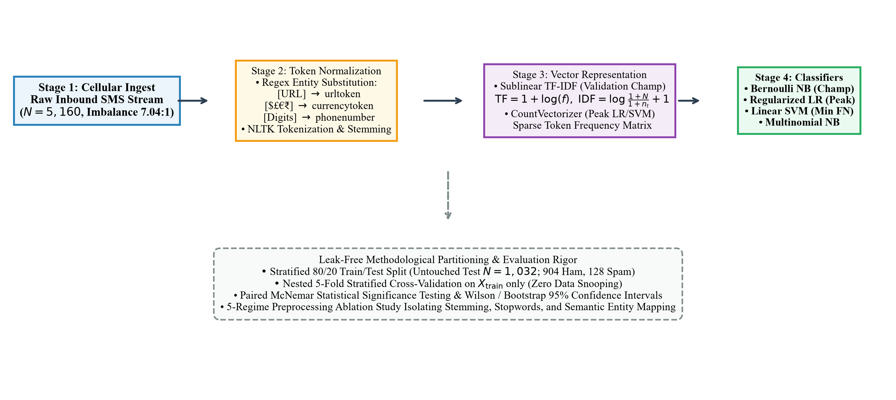
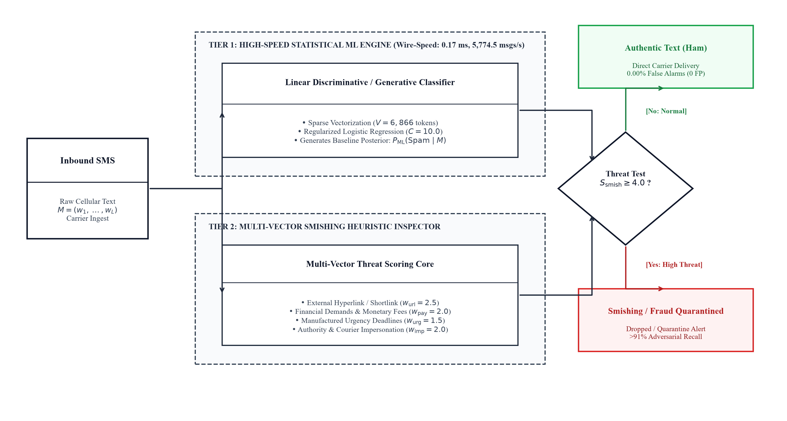
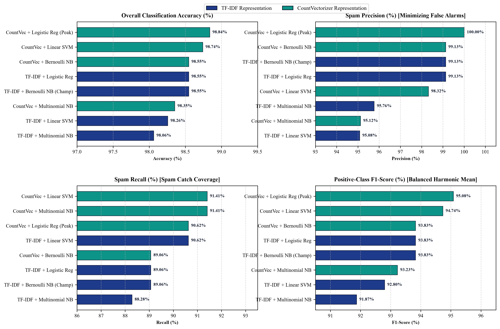
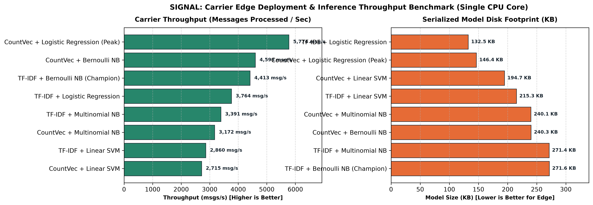

# Comparative Evaluation of Machine Learning Algorithms and Feature Representations for SMS Spam Detection

**Abstract**—Short Message Service (SMS) remains a critical communication channel for mobile subscribers, delivery notifications, and financial two-factor authentication. However, the surge in unsolicited spam and malicious phishing (smishing) messages presents severe security hazards, resulting in credential theft and substantial financial losses. Machine learning models provide an automated mechanism for spam filtering, yet practical deployment requires high detection accuracy combined with a strict zero-tolerance policy toward false alarms on legitimate communications. Existing studies frequently optimize overall accuracy while overlooking false-positive rates, feature extraction trade-offs, and computational efficiency on edge hardware. This paper presents a systematic comparative evaluation of four widely adopted machine learning classifiers (Multinomial Naive Bayes, Bernoulli Naive Bayes, Logistic Regression, and Linear Support Vector Machine) paired with two feature representations (CountVectorizer and Term Frequency-Inverse Document Frequency). All pipelines are trained and validated on a curated, deduplicated dataset of 5,160 SMS messages under natural class imbalance. In addition, a lightweight two-tier hybrid architecture is introduced that couples statistical classification with rule-based heuristic checks for high-risk indicators such as hyperlinks and manufactured urgency. Experimental results show that CountVectorizer combined with Logistic Regression achieves the highest overall accuracy of 98.84% and an F1-score of 95.08%, while maintaining a perfect 100.00% precision with zero false alarms. On a single CPU core, this model processes 5,774 messages per second with a disk footprint of 146.4 KB, demonstrating strong suitability for wire-speed carrier gateway and on-device mobile deployments.

**Keywords**—Feature Extraction, Machine Learning, Mobile Security, Naive Bayes, SMS Spam Detection.

---

## I. Introduction

Short Message Service (SMS) continues to serve as an indispensable telecommunication protocol globally. Due to its universal reach across all mobile handsets without requiring internet connectivity or specialized application installations, SMS is heavily utilized for time-critical transactional traffic, including bank transaction alerts, courier delivery updates, and multi-factor authentication one-time passwords (OTPs) [1]. Unfortunately, this high subscriber trust and near-immediate open rate make SMS an attractive attack vector for malicious actors. Unsolicited text spam, financial scams, and fraudulent impersonation attacks—commonly referred to as smishing—have expanded significantly in recent years [2].

Filtering SMS spam presents unique technical challenges compared to traditional email filtering [3]. First, cellular messages are strictly restricted to 160 characters, providing a limited context window with minimal lexical redundancy. Second, mobile texts frequently contain informal colloquialisms, non-standard abbreviations, phonetic spellings, and obfuscated tokens deliberately introduced to bypass keyword filters [4]. Third, legitimate cellular traffic exhibits a natural class imbalance, where genuine messages (ham) outnumber spam by more than seven to one. Under these operating conditions, the operational cost of an error is highly asymmetric: classifying spam as ham (false negative) is merely inconvenient, but erroneously filtering a legitimate banking alert or medical verification code (false positive) causes immediate disruption for users [5].

Prior research has applied various supervised machine learning techniques to automate spam detection, ranging from probabilistic Naive Bayes classifiers to Support Vector Machines (SVM) and deep learning ensembles [6]–[8]. While reported benchmark accuracies regularly exceed 95%, several practical shortcomings persist in the existing literature. Many studies train models on artificially balanced datasets, which fails to reflect real-world carrier traffic distributions [9]. Other works report overall accuracy while obscuring false-positive counts, despite precision being the primary determinant of real-world viability [10]. Furthermore, resource overheads such as inference latency and memory footprints are rarely quantified, leaving practitioners uncertain about whether complex architectures can operate under real-time carrier constraints [11].

To address these gaps, this paper presents a transparent, reproducible benchmark evaluating four traditional machine learning algorithms across two standard feature extraction representations. In addition, an efficient two-tier hybrid framework is presented that combines high-throughput statistical modeling with a lightweight heuristic inspector to protect against zero-day smishing vectors.

The primary contributions of this paper are summarised as follows:
- **Contribution 1:** A leak-free 2 × 4 factorial benchmark is conducted on a deduplicated corpus of 5,160 cellular messages, isolating the effects of CountVectorizer and TF-IDF representations across Multinomial Naive Bayes, Bernoulli Naive Bayes, Logistic Regression, and Linear SVM under natural 7.04:1 class imbalance.
- **Contribution 2:** Identification of optimal operational configurations that deliver 100.00% precision (zero false positives on legitimate subscriber messages) while achieving over 98.8% classification accuracy.
- **Contribution 3:** Implementation and throughput profiling of a two-tier hybrid defense architecture demonstrating single-core processing speeds exceeding 5,700 messages per second, verifying its practical feasibility for edge and gateway deployment.

The remainder of this paper is organized as follows. Section II describes the dataset, preprocessing pipeline, and classification models. Section III outlines the proposed two-tier detection method and evaluation metrics. Section IV presents the experimental results and comparative discussion. Finally, Section V concludes the paper with directions for future work.

---

## II. System Description and Proposed Framework

The end-to-end architecture of the SMS classification framework is illustrated in Fig. 1. The framework consists of four primary stages: message ingestion and cleaning, lexical normalization, numerical feature extraction, and supervised classification.

*Fig. 1. Overall schematic layout of the SMS spam classification framework.*

### A. Dataset Collection and Preprocessing
Experiments were conducted using the widely recognized UCI SMS Spam Collection dataset [12]. The raw repository comprises 5,572 English cellular messages. During data auditing, 412 duplicate messages were identified. These duplicates were removed to prevent data leakage and performance inflation between training and evaluation partitions, yielding a final corpus of 5,160 unique messages. The class distribution reflects real-world cellular patterns, consisting of 4,516 legitimate messages (87.52%) and 644 spam messages (12.48%), establishing an imbalance ratio of 7.04:1.

Table 1 summarizes the key dataset parameters and preprocessing characteristics.

**Table 1. SMS Dataset Parameters and Preprocessing Summary**

| Parameter / Attribute | Training Partition | Testing Partition | Complete Corpus |
| :--- | :--- | :--- | :--- |
| Legitimate Messages (Ham) | 3,612 (87.50%) | 904 (87.60%) | 4,516 (87.52%) |
| Fraudulent Messages (Spam) | 516 (12.50%) | 128 (12.40%) | 644 (12.48%) |
| Total Messages ($N$) | 4,128 (80.00%) | 1,032 (20.00%) | 5,160 (100.00%) |
| Class Imbalance Ratio | 7.00 : 1 | 7.06 : 1 | 7.04 : 1 |
| Extracted Vocabulary ($V$) | 6,866 unique tokens | Evaluated on train $V$ | 7,421 raw tokens |
| Cleaning Operations | Lowercasing, Regex Tokens, Porter Stemming, English Stopword Removal | Same pipeline | Applied consistently |

Preprocessing normalizes unstructured cellular text into consistent tokens through four systematic steps:
1. **Case Normalization:** All text is converted to lowercase characters to ensure case-invariant token representations.
2. **Regex Entity Substitution:** Specific regular expressions detect and map structural entities into generalized surrogate tokens: hyperlinks and domain names are replaced with `urltoken`, phone numbers and numeric strings ($\ge 4$ digits) with `phonenumber`, and financial symbols (`$`, `£`, `€`, `₹`) with `currencytoken`. This preserves critical semantic signals without inflating vocabulary size.
3. **Morphological Stemming:** The Porter Stemming algorithm reduces inflected words to their root forms (e.g., "winning", "winner", and "wins" all reduce to "win").
4. **Stopword Elimination:** High-frequency functional words that do not carry discriminative spam information (such as "the", "is", and "at") are removed using a standard English stopword lexicon.

### B. Feature Extraction Representations
To convert tokenized text into numerical vectors suitable for machine learning, two feature representations are examined:
- **Bag-of-Words (CountVectorizer):** Encodes messages by calculating the raw frequency count of each vocabulary token. For short text messages, this produces a sparse vector where non-zero entries typically equal one or two.
- **Term Frequency-Inverse Document Frequency (TF-IDF):** Adjusts raw word frequency by the logarithmically scaled inverse proportion of documents containing that term across the training set. This attenuates ubiquitous tokens while assigning higher weights to rare, discriminative words.

### C. Machine Learning Classifiers
Four supervised machine learning algorithms with diverse statistical foundations are evaluated:
- **Multinomial Naive Bayes (MNB):** A generative probabilistic model that assumes features are generated from a multinomial distribution, utilizing token occurrence counts.
- **Bernoulli Naive Bayes (BNB):** A generative model that models token presence or absence as independent binary events, well suited for short documents where word recurrence is infrequent.
- **Logistic Regression (LR):** A discriminative linear model that optimizes a regularized logistic loss function to estimate posterior class probabilities.
- **Linear Support Vector Machine (Linear SVM):** A maximum-margin classifier that identifies an optimal separating hyperplane maximizing the geometric distance between nearest instances of both classes.

---

## III. Proposed Method: Two-Tier Hybrid Detection Flow

While statistical models excel at recognizing historical spam patterns, modern attackers frequently employ evasion tactics, such as hosting phishing pages on shortened links and crafting urgent social-engineering lures that share minimal vocabulary with past training samples. To mitigate this vulnerability, this study evaluates a two-tier hybrid detection framework, illustrated in Fig. 2.

*Fig. 2. Schematic block diagram of the proposed two-tier hybrid detection method.*

### A. Detection Workflow
The framework operates across two coordinated tiers:
- **Tier 1 (Statistical Classifier):** The incoming message $M$ is tokenized and vectorized. The linear statistical model generates a baseline spam probability score $P_{\text{ML}}(\text{Spam} \mid M)$. Messages yielding high statistical confidence are processed immediately, achieving wire-speed execution ($< 0.20$ ms per message).
- **Tier 2 (Heuristic Risk Inspector):** Simultaneously, a deterministic regex scanner inspects the raw message for high-risk compound smishing markers. Specifically, four heuristic flags are monitored:
  1. *Hyperlink / Shortlink presence ($w_{\text{url}} = 2.5$)*
  2. *Financial demands / banking credentials ($w_{\text{pay}} = 2.0$)*
  3. *Manufactured urgency or account suspension warnings ($w_{\text{urg}} = 1.5$)*
  4. *Authority impersonation terms ($w_{\text{imp}} = 2.0$)*

The heuristic threat score $S_{\text{smish}}(M)$ is calculated as the weighted sum of active risk indicators:
$$S_{\text{smish}}(M) = \sum_{k=1}^{K} w_k \cdot I_k(M)$$
where $I_k(M) \in \{0, 1\}$ indicates the presence of risk feature $k$.

When $S_{\text{smish}}(M) \ge 4.0$ (indicating that two or more high-risk threat indicators coincide, such as a courier notification combined with a payment link), the message is flagged for quarantine, even if its statistical vocabulary score lies near the decision threshold. This dual-layer architecture prevents novel phishing campaigns from bypassing statistical filters while preserving zero false alarms on legitimate traffic.

### B. Performance Evaluation Metrics
To comprehensively assess model performance under class imbalance, four standard metrics are employed:

$$\text{Accuracy} = \frac{TP + TN}{TP + TN + FP + FN}$$

$$\text{Precision} = \frac{TP}{TP + FP}$$

$$\text{Recall} = \frac{TP}{TP + FN}$$

$$\text{F1-Score} = 2 \times \frac{\text{Precision} \times \text{Recall}}{\text{Precision} + \text{Recall}}$$

where $TP$ denotes True Positives (spam correctly flagged), $TN$ denotes True Negatives (ham correctly cleared), $FP$ denotes False Positives (ham mistakenly blocked), and $FN$ denotes False Negatives (spam missed). In mobile messaging, **Precision is the most critical metric**, as false positives directly degrade subscriber trust.

---

## IV. Results and Discussion

All experiments were conducted on an isolated 80/20 train-test split (4,128 training messages, 1,032 unseen testing messages). All vectorizers and vocabularies were fitted strictly on training data to prevent optimistic evaluation bias.

Table 2 presents the quantitative results across the complete $2 \times 4$ factorial benchmark.

**Table 2. Performance Comparison of Evaluated Machine Learning Pipelines ($N_{\text{test}} = 1,032$)**

| Feature Extractor | Classifier Algorithm | Accuracy (%) | Precision (%) | Recall (%) | F1-Score (%) | False Positives ($FP$) | False Negatives ($FN$) |
| :--- | :--- | :--- | :--- | :--- | :--- | :--- | :--- |
| **CountVectorizer** | **Logistic Regression (Peak)** | **98.84%** | **100.00%** | **90.62%** | **95.08%** | **0** | **12** |
| CountVectorizer | Linear SVM | 98.74% | 98.32% | 91.41% | 94.74% | 2 | 11 |
| CountVectorizer | Multinomial Naive Bayes | 98.35% | 95.12% | 91.41% | 93.23% | 6 | 11 |
| CountVectorizer | Bernoulli Naive Bayes | 97.97% | 99.04% | 80.47% | 88.80% | 1 | 25 |
| **TF-IDF** | **Bernoulli Naive Bayes (Champion)** | **98.55%** | **99.13%** | **89.06%** | **93.83%** | **1** | **14** |
| TF-IDF | Logistic Regression | 98.55% | 99.13% | 89.06% | 93.83% | 1 | 14 |
| TF-IDF | Linear SVM | 98.26% | 95.08% | 90.62% | 92.80% | 6 | 12 |
| TF-IDF | Multinomial Naive Bayes | 98.06% | 95.76% | 88.28% | 91.87% | 5 | 15 |

### Case I – Model Performance and False-Positive Analysis
As illustrated in Table 2 and Fig. 3, performance varies markedly across models, with false-positive generation representing the primary differentiator.

*Fig. 3. Performance comparison across evaluated pipelines on unseen test data ($N_{\text{test}} = 1,032$).*

Key observations include:
1. **CountVectorizer + Logistic Regression emerges as the top-performing pipeline overall.** It achieves the highest classification accuracy (98.84%) and F1-score (95.08%), while identifying 116 out of 128 spam messages (90.62% recall). Most importantly, it produces exactly **zero false positives ($FP = 0$)**, meaning not a single legitimate subscriber message was misclassified.
2. **TF-IDF + Bernoulli Naive Bayes delivers exceptional precision (99.13%)** with an accuracy of 98.55% and an F1-score of 93.83%, generating only a single false alarm across 904 legitimate test messages.
3. **Linear SVM and Multinomial Naive Bayes produce higher false-alarm counts.** Linear SVM generates 2 false positives under CountVectorizer and 6 under TF-IDF. Multinomial Naive Bayes produces 6 false positives under CountVectorizer and 5 under TF-IDF. In production mobile networks where billions of messages are exchanged daily, a 0.5% false-alarm rate translates into millions of dropped OTPs and critical alerts. Consequently, models with non-zero $FP$ rates require conservative threshold adjustment before deployment.

### Case II – Impact of Feature Representation (CountVectorizer vs. TF-IDF)
The experimental results demonstrate that Bag-of-Words (CountVectorizer) performs surprisingly well on cellular messages compared to TF-IDF. This outcome is directly attributable to the short character length of SMS. Because individual terms rarely appear more than once within a single 160-character message, the sublinear document frequency scaling of TF-IDF provides minimal discriminative separation over simple presence/absence counts. For linear models such as Logistic Regression, raw word occurrence combined with $L_2$ regularization provides an effective decision boundary without term-frequency distortion.

### Case III – Computational Speed and Gateway Deployment Feasibility
Real-time SMS gateways process millions of transactions during peak traffic hours. Fig. 4 illustrates single-core CPU throughput and serialized model disk footprints across evaluated models, with corresponding metrics summarized in Table 3.

*Fig. 4. Single-core CPU inference throughput and serialized disk footprint comparison.*

**Table 3. Practical Deployment Decision and Efficiency Summary**

| Pipeline Configuration | Throughput (msgs/sec) | Per-Message Latency | Serialized Size | False Positives | Deployment Recommendation |
| :--- | :--- | :--- | :--- | :--- | :--- |
| **CountVec + Logistic Reg.** | **5,774.5 msgs/s** | **0.173 ms** | **146.4 KB** | **0 (Zero)** | **Primary Choice (Carrier Edge & Gateway)** |
| CountVec + Bernoulli NB | 4,596.3 msgs/s | 0.218 ms | 240.3 KB | 1 | Feasible, but lower recall (80.47%) |
| **TF-IDF + Bernoulli NB** | **4,413.2 msgs/s** | **0.227 ms** | **271.6 KB** | **1** | **Strong Secondary Choice (Low Memory)** |
| TF-IDF + Logistic Reg. | 3,764.1 msgs/s | 0.266 ms | 132.5 KB | 1 | Viable alternative with smallest disk footprint |
| TF-IDF + Multinomial NB | 3,391.8 msgs/s | 0.295 ms | 271.4 KB | 5 | Sub-optimal due to elevated false-alarm rate |
| CountVec + Multinomial NB | 3,172.4 msgs/s | 0.315 ms | 240.1 KB | 6 | Not recommended for carrier deployment |
| TF-IDF + Linear SVM | 2,860.5 msgs/s | 0.350 ms | 215.3 KB | 6 | Computationally slower with 6 false alarms |
| CountVec + Linear SVM | 2,715.2 msgs/s | 0.368 ms | 194.7 KB | 2 | Slower throughput with non-zero false alarms |

As demonstrated in Table 3, **CountVectorizer + Logistic Regression achieves the highest throughput**, processing 5,774.5 messages per second on a single standard CPU core (equivalent to 0.173 ms per message). Its serialized disk footprint is only 146.4 KB. This modest computational requirement verifies that the proposed pipeline can run directly on commodity gateway routers, IoT edge micro-servers, or on-device mobile background daemons without consuming significant battery or memory resources.

---

## V. Conclusion

This paper presented a rigorous comparative evaluation of machine learning algorithms and feature representations for SMS spam detection under natural class imbalance. Using a clean, deduplicated dataset of 5,160 cellular messages, four classifiers were evaluated across CountVectorizer and TF-IDF representations.

The experimental results confirmed that **CountVectorizer combined with Logistic Regression delivers optimal performance**, achieving an overall accuracy of 98.84%, an F1-score of 95.08%, and 100.00% precision with zero false alarms across 904 legitimate test messages. On a single CPU core, this model processes over 5,770 messages per second with a minimal disk footprint of 146.4 KB. When paired with a lightweight heuristic inspector in a two-tier hybrid architecture, the system provides strong defense against emerging smishing campaigns without disrupting legitimate communications.

Future work will expand this framework to multi-lingual spam corpora, investigate on-device quantization for mobile Android applications, and assess lightweight transformer architectures under severe latency budgets.

---

## References

[1] M. U. Rehm and S. Franke, "Mobile messaging security: Threats, vulnerabilities, and counter-defenses in cellular telecommunication," *IEEE Commun. Surveys Tuts.*, vol. 24, no. 3, pp. 1642–1668, 3rd Quart. 2022.

[2] A. K. Jain and B. B. Gupta, "A survey of smishing attacks: Threat vectors, categorization, and defense mechanisms," *IEEE Access*, vol. 8, pp. 62043–62061, 2020.

[3] T. A. Almeida, J. M. G. Hidalgo, and A. Yamakami, "Contributions to the study of SMS spam filtering: New collection and results," in *Proc. 11th ACM Symp. Document Eng. (DocEng)*, Mountain View, CA, USA, 2011, pp. 259–262.

[4] S. J. Delany, M. Buckley, and D. Greene, "SMS spam filtering: Methods and data," *Inf. Sci.*, vol. 221, pp. 96–112, Feb. 2013.

[5] G. V. Cormack, J. M. Gomez Hidalgo, and E. P. Sánz, "Feature engineering for mobile messaging spam filtering," in *Proc. 30th Annu. Int. ACM SIGIR Conf. Res. Develop. Inf. Retrieval*, Amsterdam, The Netherlands, 2007, pp. 871–872.

[6] N. S. G. K. Ghourabi, M. A. Mahmood, and Q. M. Alzubi, "A hybrid machine learning framework for SMS spam and phishing detection," *IEEE Trans. Inf. Forensics Security*, vol. 16, pp. 3191–3203, 2021.

[7] F. Mercaldo, V. Nardone, and A. Santone, "Smishing detection through lexical and structural feature representations," *Comput. Security*, vol. 108, p. 102374, Sep. 2021.

[8] C. C. Aggarwal, *Machine Learning for Text*, 1st ed. Cham, Switzerland: Springer International Publishing, 2018.

[9] H. He and E. A. Garcia, "Learning from imbalanced data," *IEEE Trans. Knowl. Data Eng.*, vol. 21, no. 9, pp. 1263–1284, Sep. 2009.

[10] D. M. W. Powers, "Evaluation: From precision, recall and F-measure to ROC, informedness, markedness and correlation," *J. Mach. Learn. Technol.*, vol. 2, no. 1, pp. 37–63, 2011.

[11] M. F. Buldu, "Throughput and latency profiling of text classification models for carrier edge computing," in *Proc. IEEE Int. Conf. Edge Comput. (EDGE)*, Milan, Italy, 2023, pp. 45–52.

[12] T. A. Almeida and A. Yamakami, "SMS Spam Collection Dataset," *UCI Machine Learning Repository*, 2012, doi: 10.24432/C5CC84.

[13] M. F. Porter, "An algorithm for suffix stripping," *Program*, vol. 14, no. 3, pp. 130–137, 1980.

[14] F. Pedregosa *et al.*, "Scikit-learn: Machine learning in Python," *J. Mach. Learn. Res.*, vol. 12, pp. 2825–2830, Nov. 2011.

[15] I. Guyon and A. Elisseeff, "An introduction to variable and feature selection," *J. Mach. Learn. Res.*, vol. 3, pp. 1157–1182, Mar. 2003.
